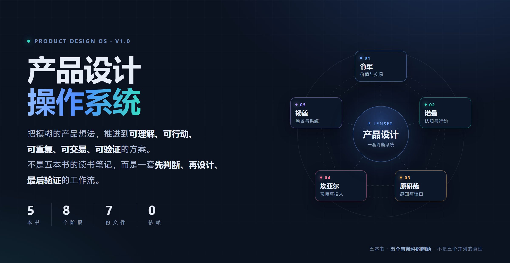
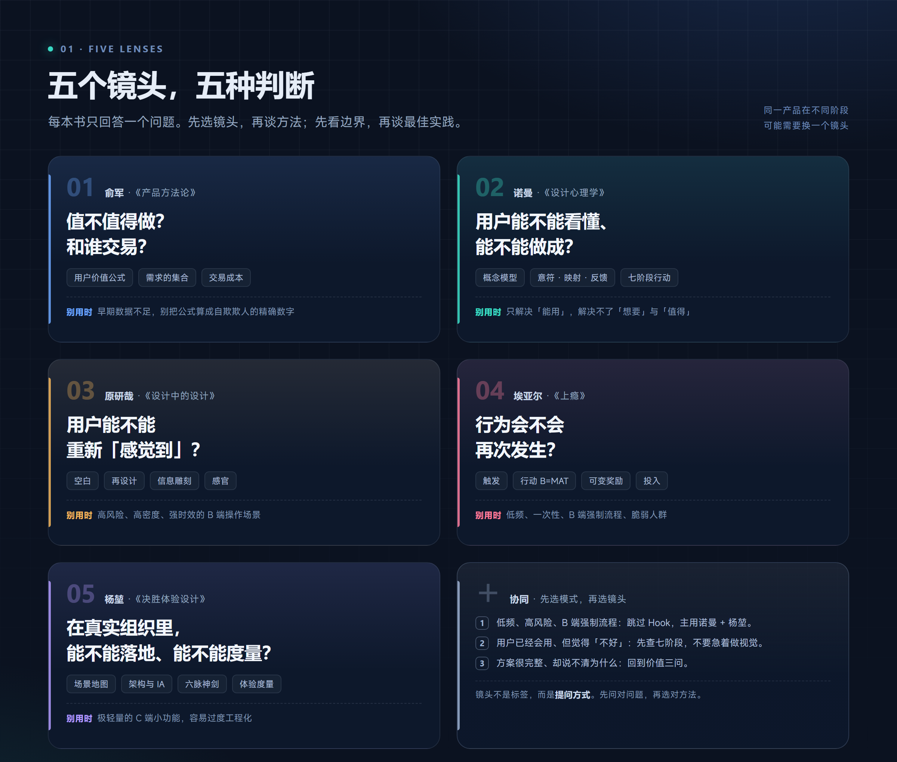
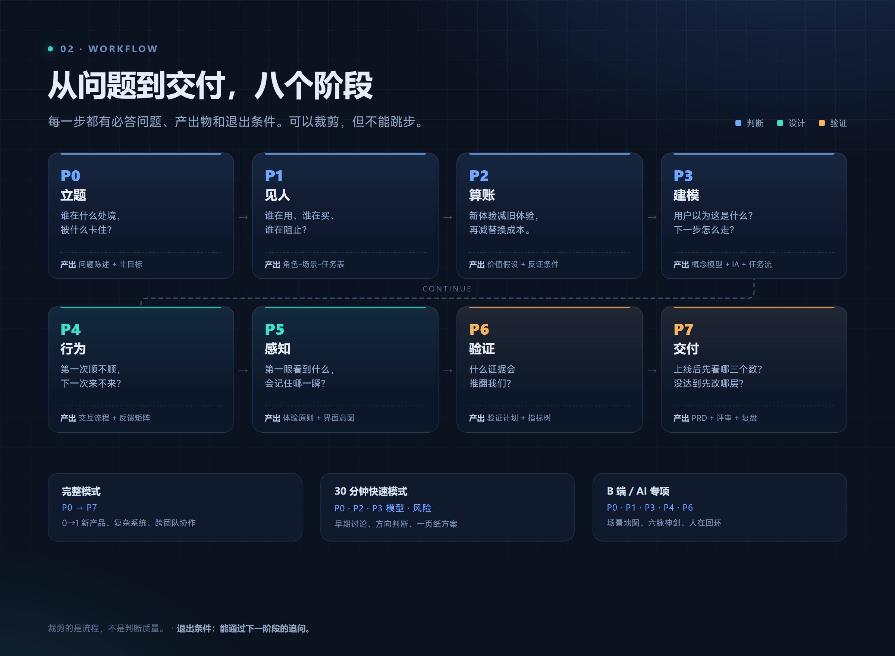
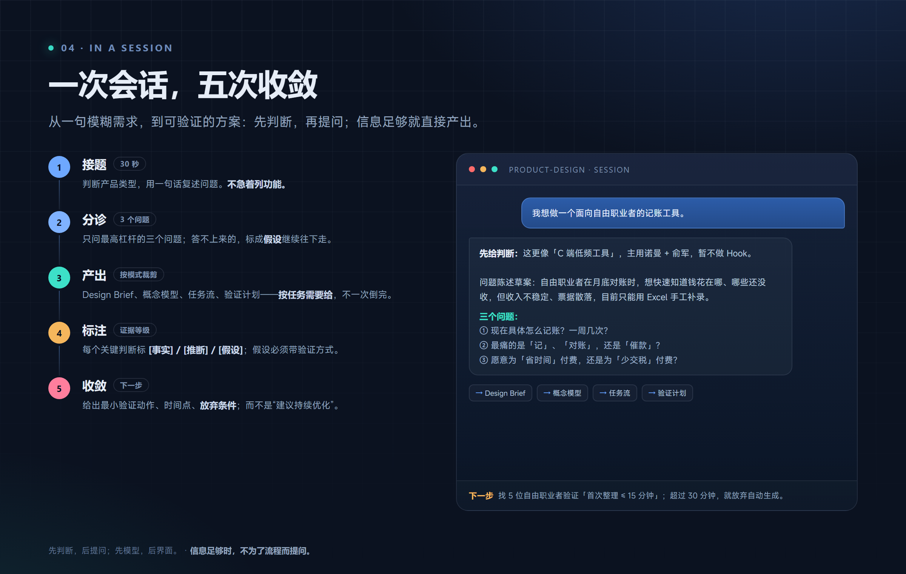
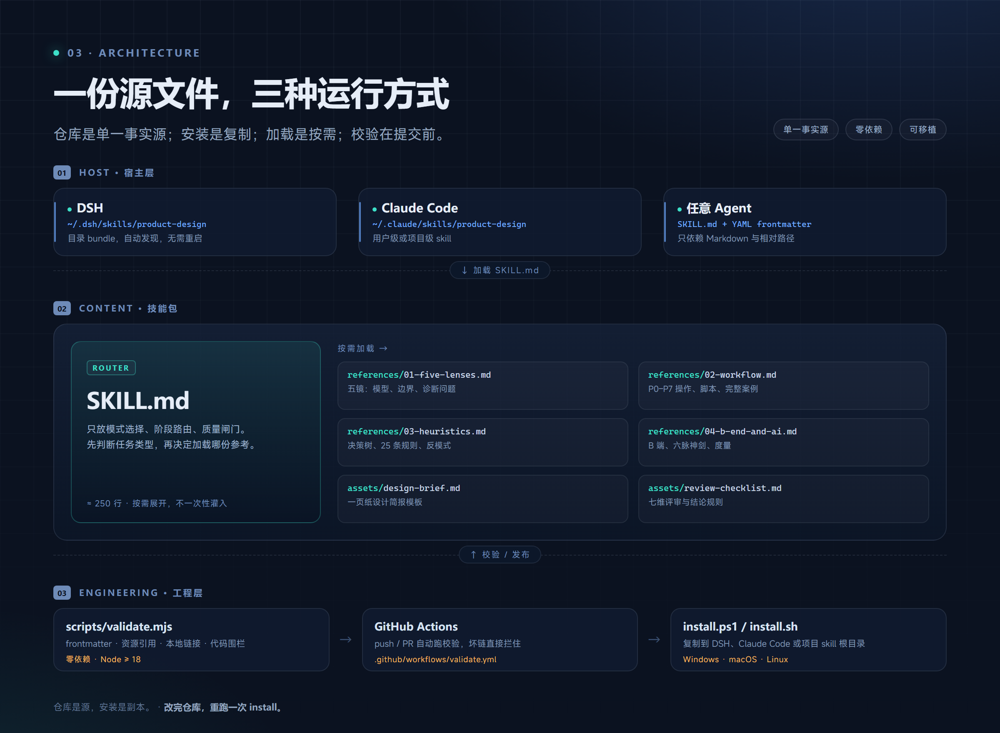

# Product Design OS · 产品设计操作系统

> 把模糊的产品想法，推进到**可理解、可行动、可重复、可交易、可验证**的方案。

[](LICENSE)
[](skills/product-design/SKILL.md)
[](README.md)
[](scripts/validate.mjs)

[](docs/assets/hero.png)

<p align="center"><sub>五本书 · 五个有条件的问题 · 一套先判断、再设计、最后验证的工作流</sub></p>

---

## 目录

- [这是什么](#这是什么)
- [为什么是这五本书](#为什么是这五本书)
- [五个镜头如何协同](#五个镜头如何协同)
- [工作流：P0–P7](#工作流p0p7)
- [一次会话如何发生](#一次会话如何发生)
- [仓库架构](#仓库架构)
- [安装](#安装)
- [使用](#使用)
- [它会产出什么](#它会产出什么)
- [设计原则](#设计原则)
- [质量校验](#质量校验)
- [兼容性](#兼容性)
- [FAQ](#faq)
- [边界与免责声明](#边界与免责声明)
- [贡献](#贡献)
- [License](#license)
- [致谢](#致谢)

---

## 这是什么

一个给 AI agent 用的产品设计 skill。

装进 DSH、Claude Code 或任意支持 `SKILL.md` 的宿主后，它按一套固定的判断顺序工作：

1. **值不值得做**（俞军）：谁在什么处境、旧体验是什么、替换成本谁承担。
2. **能不能懂、能不能做**（诺曼）：概念模型、意符、反馈、异常。
3. **有没有感觉**（原研哉）：空白、层级、克制。
4. **会不会再来**（埃亚尔）：触发、行动、可变奖励、投入。
5. **能不能在组织里落地**（杨堃）：角色、场景、架构、度量。

它不替你写 PRD。它让你在写 PRD 之前，先把不该做的砍掉、把没想清的标成假设、把要验证的写清楚。

### 它不是什么

- **不是 prompt 模板合集**：模板告诉你「填什么」，它先判断「该不该填、用哪套」。
- **不是五本书的读书笔记**：它不复述章节，而是把五套理论拆成有适用条件的判断规则。
- **不是万能方法论**：每个镜头都写了「什么时候别用」，冲突时回到问题陈述与用户处境。

### 它和普通 prompt 合集的区别

| 维度 | 普通 prompt 合集 | Product Design OS |
|---|---|---|
| 组织方式 | 按任务堆模板 | 按判断顺序路由 |
| 建议 | 通用最佳实践 | 有适用条件与失效条件 |
| 输出 | 看起来完整 | 标注 `[事实] / [推断] / [假设]` |
| 边界 | 很少说「不该用」 | 每个镜头都有「别用时」 |
| 维护 | 复制即走 | 校验脚本 + CI + 变更记录 |

---

## 为什么是这五本书

[](docs/assets/five-lenses.png)

<p align="center"><sub>图 1 · 五本书的定位、核心工具，以及「什么时候别用」（点击看大图）</sub></p>

这五本书不是随便选的：它们分别对应产品设计中最容易断掉的五根链条——**价值、认知、感知、习惯、系统**。

| 书 | 回答的问题 | 核心工具 | 缺了它会怎样 |
|---|---|---|---|
| 俞军《产品方法论》 | 值不值得做？和谁交易？ | 用户价值公式、需求的集合、交易成本 | 做出「好用但没人需要」 |
| 诺曼《设计心理学》 | 用户能不能看懂、能不能做成？ | 概念模型、意符、映射、反馈、七阶段行动 | 做出「有价值但不会用」 |
| 原研哉《设计中的设计》 | 用户能不能重新「感觉到」？ | 空白、再设计、信息雕刻、感官 | 做出「能用但不想用」 |
| 埃亚尔《上瘾》 | 行为会不会再次发生？ | 触发、行动、可变奖励、投入 | 做出「用一次就走」 |
| 杨堃《决胜体验设计》 | 在真实组织里能不能落地、能不能度量？ | 场景地图、架构与 IA、六脉神剑、体验度量 | 做出「Demo 惊艳、上线跑不通」 |

### 每本书最值得拿走的一句

- **俞军**：用户不是自然人，是需求的集合；用户价值 =（新体验 − 旧体验）− 替换成本。
- **诺曼**：用户犯错，先修设计，不要修用户。
- **原研哉**：设计不是造物，是让人重新看见已知之物。
- **埃亚尔**：习惯 = 触发 + 行动 + 可变奖励 + 投入；但先问这件事值不值得用户反复来。
- **杨堃**：B 端体验不是界面美观，而是业务链路、应用架构、数据架构的综合结果。

> 五本书不是五个并列的真理，而是五个**有条件**的镜头。少一个会偏，五个平均用力会互相打架。

---

## 五个镜头如何协同

先判断任务类型，再决定镜头顺序。不要从「我最熟的方法」出发。

| 任务 | 镜头顺序 |
|---|---|
| 0→1 新产品 | 俞军（价值）→ 诺曼（模型）→ 原研哉（感知）→ 埃亚尔（复访） |
| 功能迭代 | 诺曼（卡点）→ 俞军（增量）→ 杨堃（异常/权限） |
| 体验诊断 | 诺曼（七阶段）→ 杨堃（场景/度量）→ 原研哉（层级） |
| 留存/习惯 | 埃亚尔（Hook）→ 俞军（价值是否成立）→ 伦理审查 |
| B 端系统 | 杨堃（场景地图）→ 诺曼（工作台/表单）→ 俞军（角色间交易） |
| AI 功能 | 杨堃（任务分诊）→ 诺曼（人机分工）→ 埃亚尔（使用频率） |

**三条裁决规则**：

1. **低频、高风险、B 端强制流程**：跳过埃亚尔，主用诺曼 + 杨堃。习惯模型在这里通常无效，甚至有害。
2. **高风险、高密度、强时效**：不要用大面积留白。克制不能牺牲可发现性。
3. **早期数据不足**：价值公式只做「结构化假设 + 反证条件」，不要算成自欺欺人的精确数字。

如果两个镜头打架，回到问题陈述与用户处境，而不是选一个「更高级」的理论。

---

## 工作流：P0–P7

[](docs/assets/workflow.png)

<p align="center"><sub>图 2 · P0–P7 与三种裁剪路径：完整模式、30 分钟、B 端 / AI 专项（点击看大图）</sub></p>

| 阶段 | 必答问题 | 产出 | 退出条件 |
|---|---|---|---|
| **P0 立题** | 谁最痛？不做会怎样？为什么是现在？ | 问题陈述 + 非目标 + 产品类型 | 问题陈述里没有功能名，且能复述 |
| **P1 见人** | 谁在用、谁在买、谁在阻止？失败代价多大？ | 角色-场景-任务表 + 现状旅程 | 每个场景落到具体的人、时间、替代动作 |
| **P2 算账** | 新体验增量是什么？为什么现在换？替换成本谁承担？ | 价值假设 + 交易图 + 反证条件 | 一句话说清「用户为什么会换」 |
| **P3 建模** | 用户以为这是什么？第一次怎么知道下一步？出错怎么恢复？ | 概念模型 + IA + 主/异常任务流 | 纸面推演下，新用户能完成主任务 |
| **P4 行为** | 触发来自情绪还是场景？30 秒内获得什么价值？ | 交互流程 + 反馈矩阵 +（可选）Hook | 主路径每一步都有「下一步」和「结果感」 |
| **P5 感知** | 第一眼看到什么？删掉一半还成立吗？ | 3–5 条体验原则 + 界面意图 | 每条原则都能指导一个具体取舍 |
| **P6 验证** | 什么证据会推翻我们？多久能拿到？ | 验证计划 + 指标树 + 放弃条件 | 每个关键假设都有验证动作 |
| **P7 交付** | 上线先看哪三个数？没达到先改哪层？ | PRD + 评审记录 + 复盘 | 三方对「成功」有同一个定义 |

### 三种裁剪

| 模式 | 路径 | 适用 |
|---|---|---|
| **完整模式** | P0 → P7 | 0→1 新产品、复杂系统、跨团队协作 |
| **30 分钟快速模式** | P0 · P2 · P3 概念模型 · Top 3 风险 | 早期讨论、方向判断、一页纸方案 |
| **B 端 / AI 专项** | P0 · P1 · P3 · P4 · P6 | 场景地图、六脉神剑、人在回环 |

### 为什么是这八个阶段

它不是瀑布，而是**判断顺序**：先把价值说清（P0–P2），再把模型画对（P3），再设计行为与感知（P4–P5），最后才用证据收敛（P6–P7）。

- 跳过 P0–P2，会做出「精致但没人要」的东西；
- 跳过 P3，会用界面补结构的洞；
- 跳过 P6，会把「上线」当「成功」；
- P7 的复盘要回填 P2 的价值公式，所以箭头是闭环，不是直线。

---

## 一次会话如何发生

[](docs/assets/session.png)

<p align="center"><sub>图 3 · 一次会话的五次收敛：接题、分诊、产出、标注、收敛（点击看大图）</sub></p>

典型开场不是「给我 20 个功能」，而是：

```text
用户：我想做一个面向自由职业者的记账工具。

Skill：先给判断：这更像「C 端低频工具」，主用诺曼 + 俞军，暂不做 Hook。

问题陈述草案：自由职业者在月底对账时，想快速知道钱花在哪、哪些还没收，
但收入不稳定、票据散落，目前只能用 Excel 手工补录。

三个问题：
1. 现在具体怎么记账？一周几次？
2. 最痛的是「记」、「对账」，还是「催款」？
3. 愿意为「省时间」付费，还是为「少交税」付费？

下一步：拿到回答后给价值公式与概念模型；先不做功能清单。
```

**它不会**：

- 一上来列 20 个功能，用功能数量冒充方案完整度；
- 把「用户说喜欢」当结论，把假设写成事实；
- 用「建议持续优化」收尾，而不给验证动作与放弃条件。

---

## 仓库架构

[](docs/assets/architecture.png)

<p align="center"><sub>图 4 · 三层架构：宿主层负责加载，内容层负责判断，工程层负责校验与分发（点击看大图）</sub></p>

| 层 | 组成 | 职责 |
|---|---|---|
| **宿主层** | DSH、Claude Code、任意支持 `SKILL.md` 的 Agent | 发现 skill、加载主文件、按需读取参考 |
| **内容层** | `SKILL.md` + `references/` + `assets/` | 路由、判断、模板 |
| **工程层** | `scripts/` + `.github/workflows/` + `docs/` | 校验、安装、图示、发布 |

### 为什么这样分

- **`SKILL.md` 只留约 250 行**：它负责「什么时候用哪一招」，不负责讲完所有细节。上下文是预算，不是仓库。
- **`references/` 一个主题一份**：五镜、工作流、判断规则、B 端/AI 各自独立修订，互不牵连。
- **`assets/` 独立**：Design Brief 与评审清单可以直接复制到 PRD、评审会、需求文档里。
- **`scripts/` 零依赖**：校验与安装不需要 `npm install`，降低使用门槛。
- **`docs/diagrams/` 保留源码**：图不是一次性截图，改文案后可以重跑渲染。

> 仓库是**单一事实源**，安装只是复制。改完仓库后重跑一次 `install`，不要在两份副本上分别改。

<details>
<summary><b>展开完整文件树</b></summary>

```text
product-design-skill/
├── skills/
│   └── product-design/
│       ├── SKILL.md
│       ├── references/
│       │   ├── 01-five-lenses.md
│       │   ├── 02-workflow.md
│       │   ├── 03-heuristics.md
│       │   └── 04-b-end-and-ai.md
│       └── assets/
│           ├── design-brief.md
│           └── review-checklist.md
├── docs/
│   ├── diagrams/                  # 图示源码（HTML + CSS）
│   │   ├── base.css
│   │   ├── hero.html
│   │   ├── five-lenses.html
│   │   ├── workflow.html
│   │   ├── architecture.html
│   │   └── session.html
│   ├── assets/                    # 渲染后的 2x PNG
│   │   ├── hero.png
│   │   ├── five-lenses.png
│   │   ├── workflow.png
│   │   ├── architecture.png
│   │   └── session.png
│   ├── DIAGRAMS.md                # 图示系统说明
│   └── PUBLISHING.md              # 发布与版本流程
├── scripts/
│   ├── validate.mjs               # 零依赖校验
│   ├── render-diagrams.ps1        # 重新渲染五张图（Windows）
│   ├── render-diagrams.sh         # 重新渲染五张图（macOS / Linux）
│   ├── install.ps1
│   └── install.sh
├── .github/
│   ├── workflows/validate.yml
│   └── pull_request_template.md
├── README.md
├── README.en.md
├── CONTRIBUTING.md
├── CHANGELOG.md
├── LICENSE
├── package.json
├── .gitattributes
└── .gitignore
```

</details>

---

## 安装

### DSH（DeepSeek Harness）

```powershell
# 用户级：~/.dsh/skills/product-design
powershell -ExecutionPolicy Bypass -File .\scripts\install.ps1

# 项目级：<project>/.dsh/skills/product-design
powershell -ExecutionPolicy Bypass -File .\scripts\install.ps1 -Target project -ProjectPath E:\your-project
```

安装后新开会话即可在 skill 目录里看到 `product-design`，无需重启宿主。

### Claude Code

```powershell
powershell -ExecutionPolicy Bypass -File .\scripts\install.ps1 -Target claude
```

对应目录：`~/.claude/skills/product-design/SKILL.md`。

### macOS / Linux

```bash
./scripts/install.sh dsh          # ~/.dsh/skills/product-design
./scripts/install.sh claude       # ~/.claude/skills/product-design
./scripts/install.sh project /path/to/project
```

### 任意 agent / 手动

把 `skills/product-design/` 整个目录复制到该 agent 的 skill 根目录。只要它支持「目录 + `SKILL.md` + YAML frontmatter（`name` / `description`）」这一约定，就能加载。

### 验证与更新

```bash
ls ~/.dsh/skills/product-design/SKILL.md
```

更新时先 `git pull`，再重跑安装脚本。脚本会替换旧副本，不会合并。

---

## 使用

直接用自然语言提出任务即可，skill 会根据任务类型选择镜头：

```text
用 product-design 帮我设计一个面向自由职业者的记账工具。

用 product-design 评审这份 PRD：docs/prd.md。

我们用 product-design 诊断一下门店巡检系统的体验问题。

用 product-design 设计一个 B 端采购审批的 AI Copilot。
```

**它会先做三件事**：判断产品类型、用一句话复述问题、只问 3 个高杠杆问题。信息足够时直接产出，并标注 `[事实] / [推断] / [假设]`。

---

## 它会产出什么

| 产出 | 对应阶段 | 内容 |
|---|---|---|
| **Design Brief** | P0 / P2 | 问题、非目标、角色场景、价值公式、反证条件 |
| **概念模型** | P3 | 对象 / 状态 / 动作 / 规则，一张图讲清 |
| **任务流** | P3 | 主流程 + 异常流 + 状态机 |
| **Hook 工作表** | P4 | 触发、行动、可变奖励、投入、伦理结论（仅高频产品） |
| **体验原则** | P5 | 3–5 条能指导取舍的原则 + 关键界面意图 |
| **验证计划** | P6 | 假设、实验、样本、成功标准、放弃条件 |
| **PRD 骨架** | P7 | 问题、范围、流程、状态、验收、埋点、灰度 |
| **评审清单** | 任意 | 七维评分 + 分级问题 + 结论规则 |

模板在 [`assets/`](skills/product-design/assets/)，可以直接复制使用。

---

## 设计原则

1. **问题 > 方案，模型 > 界面，场景 > 功能。**
2. **区分事实、推断、假设**；关键假设必须带验证方式。
3. **不设计操纵**：透明性、受益性、可退出性、脆弱性，四问不过就不做。
4. **每个建议带取舍**：解决了什么、牺牲了什么、什么情况下不成立。
5. **发现方向性错误时先停下来指出**，不要顺着错误前提做漂亮方案。

伦理四问：

- 如果用户完全理解我们的设计意图，还会同意吗？
- 用户长期是变得更好，还是更依赖、更焦虑？
- 取消、退款、关闭、注销，是否和开通一样容易？
- 是否针对未成年人、成瘾人群、财务困难人群？

---

## 质量校验

零依赖，Node.js ≥ 18：

```bash
npm run validate
# 或
node scripts/validate.mjs
```

校验内容：

- `SKILL.md` 是否存在、frontmatter 是否合法（`name` kebab-case、`description` 非空）
- `references/` 与 `assets/` 是否被 `SKILL.md` 引用
- 全仓库 Markdown 本地链接与图片是否可达
- 代码块围栏是否成对

CI 在 [`.github/workflows/validate.yml`](.github/workflows/validate.yml)，push / PR 自动运行。

---

## 兼容性

| 宿主 | 支持方式 |
|---|---|
| DSH（DeepSeek Harness） | 目录 bundle：`<root>/product-design/SKILL.md` |
| Claude Code | 用户级/项目级 `skills/product-design/SKILL.md` |
| 其他 agent | 只要支持 `SKILL.md` + frontmatter 约定即可 |

> 不同宿主对 `description` 长度、可用工具名、资源引用方式的支持不同；本 skill 只依赖 Markdown 与相对路径，不绑定任何专有工具。

---

## FAQ

**Q：这和直接让 AI「设计一个产品」有什么区别？**

普通对话容易直接跳到功能清单。这个 skill 强制先判断类型、复述问题、只问三个问题，并在输出里标证据等级、写放弃条件。

**Q：为什么正文是中文？**

五本书的中文语境与 B 端案例以中文为主。结构、模板、frontmatter 与语言无关；英文 README 提供入口，英文正文在路线图里。

**Q：五本书打架怎么办？**

看适用条件。低频 B 端不用 Hook；高风险场景不用留白；早期不精算价值。冲突时回到问题陈述与用户处境。

**Q：适合 B 端吗？**

是重点。`references/04-b-end-and-ai.md` 专讲场景地图、角色冲突、工作台、反馈/促活/消息、六脉神剑与度量。

**Q：会替代用户研究吗？**

不会。它要求证据分级；没有数据时只能标假设，并给出验证方式。

**Q：怎么改成我们公司的版本？**

Fork 后替换 `references/` 里的案例与度量口径，保留 `SKILL.md` 的路由结构。不要把全部内容塞回主文件，否则上下文预算会失控。

**Q：为什么图是深色的？**

GitHub 浅色与深色主题下都成立，不需要维护两套图片。

**Q：可以商用吗？**

MIT。但书中概念与案例的版权归原作者/出版方；本项目不包含原文摘录。

---

## 边界与免责声明

- 这是**判断辅助**，不替代用户研究、数据分析、工程可行性验证与合规审查。
- 五本书的结论各有时代与语境；引用时请说明适用条件，不要当普适真理。
- 涉及医疗、金融、未成年人、公共安全等高风险领域，优先合规与安全，其次才是体验与增长。
- 本项目是独立的思想提炼与再组织，**不包含五本书的原文摘录**，与作者、出版方无隶属或背书关系。

---

## 贡献

欢迎补充案例、修订框架、增加翻译。请先读 [CONTRIBUTING.md](CONTRIBUTING.md)。

- 改图示：看 [docs/DIAGRAMS.md](docs/DIAGRAMS.md)
- 发布与版本：看 [docs/PUBLISHING.md](docs/PUBLISHING.md)
- 最低要求：内容可执行、有边界、不摘录原文、`npm run validate` 通过。

---

## License

[MIT](LICENSE) © 2026 product-design-skill contributors

## 致谢

- Donald A. Norman, *The Design of Everyday Things*
- 原研哉，《设计中的设计》
- Nir Eyal, *Hooked: How to Build Habit-Forming Products*
- 俞军，《俞军产品方法论》
- 杨堃，《决胜体验设计：AI 时代的 B 端用户体验设计指南》

感谢五位作者把经验写成可讨论的框架。书名与作者名仅用于说明思想来源。

---

## 项目状态

- **v1.0**：五镜框架、P0–P7、四份参考、两份模板、校验与安装脚本。
- **v1.1**：图示系统（封面 / 五镜 / 工作流 / 架构 / 会话）、README 重构、发布文档。
- **下一步**：案例库、英文正文、评分校准、更多 B 端与 AI 模板。

如果这个项目帮你少做了一次「精致但没人要」的方案，欢迎点一个 Star。
